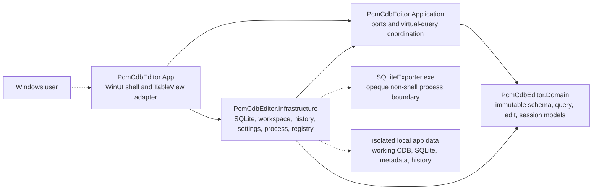

# Architecture

PCM CDB Editor separates product models and orchestration from its Windows, SQLite, filesystem, process, registry, and UI integrations. Four projects enforce those boundaries.

Solid arrows between projects show compile-time dependencies. `PcmCdbEditor.App` references Infrastructure to construct Application port implementations at startup; product behavior otherwise crosses Application contracts. Dotted arrows show user or runtime interactions. `WinUI.TableView` types remain inside `TableGridAdapterControl`.

## Project responsibilities

### Domain

`PcmCdbEditor.Domain` defines immutable SQLite storage values, row identities and revisions, runtime schema metadata, the page-independent `TableQueryDefinition`, bounded page requests, row-count state, view preferences, lifecycle models, reversible edit operations, replay guards, and maintenance previews. It has no WinUI, SQLite-package, process, registry, or filesystem dependency.

### Application

`PcmCdbEditor.Application` owns ports for conversion, workspaces, schema discovery, table data, edit history and replay, settings, file association, the grid adapter, and maintenance. It also owns:

- identifier validation against the current schema catalog;
- the numbered `AND`/`OR` advanced-filter parser;
- stable query models;
- operation gates that prevent conflicting work and suppress stale asynchronous completions;
- an inline-edit commit stager that separates pre-commit parsing from post-lifecycle mutation, plus the shared rider-ID parser; and
- virtual-query coordination for bounded pages and lazy counts, plus independently cancellable complete-result materialization through `VirtualTableQueryCoordinator.LoadAllRowsAsync`.

No package-specific UI event or SQLite connection type crosses these contracts.

### Infrastructure

`PcmCdbEditor.Infrastructure` implements the edge ports:

- non-shell exporter execution with literal argument lists, bounded sanitized diagnostics, cancellation, timeout, and process-tree termination;
- copy-first sessions, staged conversion, destination fingerprints, atomic replacement with displaced-file backup, and exclusive session ownership across recovery and cleanup;
- runtime table/view/column/key/FK discovery, conservative relationship inference, signatures, and safe edit-capability classification;
- an internal SQLite operation runner that moves UI-reachable catalog, query/count, edit/replay, workspace validation, and maintenance work off the WinUI dispatcher;
- native cancellation through `sqlite3_interrupt`, with the interrupt registration disposed before its connection and a canceled `SQLITE_INTERRUPT` translated to `OperationCanceledException`;
- parameterized bounded page queries, counts, and searches; `ITableDataStore.QueryAllRowsAsync` queries without `LIMIT` or `OFFSET`; and transactional typed insert, update, and delete operations;
- validated relationship metadata, batched label resolution, and stable database-side sorting;
- atomic settings and schema-signature-keyed column-layout state;
- disk-backed session history and guarded replay for updates, inserts, deletes, and maintenance commands; and
- per-user Windows file association plus the schema-gated maintenance workflows and the clean, atomic rider/contract creation service.

History snapshots live inside the active session because undoing deletes and maintenance requires complete typed rows. Settings and column-layout state do not contain database row values, but recent-file settings can contain local filesystem paths. Sort descriptors remain in the App context for each open table tab and are never written to settings.

### App

`PcmCdbEditor.App` provides the high-density WinUI 3 shell, responsive navigation, command/status surfaces, multiple table tabs, row inspector, recovery and confirmation dialogs, settings, and maintenance previews. It composes:

- copy-first picker, command-line, recent-file, and association activation;
- target-named table loading in which only the current request may bind rows, change status, or dismiss the loading surface;
- cancellation that restores the previous completed tab and focus, plus lazy finite-page counts that update count text without rebinding rows;
- an App-private `TableDisplayWindow` that owns the selected row choice, offset, completed rows, and `HasMore` state independently of the bounded `PageRequest`;
- bounded 100-, 250-, and 500-row browsing, plus an explicit all-row mode that uses offset zero, `HasMore = false`, an exact completed-row count, disabled paging controls, and no lazy count;
- IDs only, Names only, and Names and IDs display modes for recognized relationships;
- typed inline edits that preserve the existing SQLite storage class;
- a full-row editor with explicit Integer, Real, Text, and NULL choices while treating BLOBs as read-only metadata;
- rider recovery by explicit ID list or lazily loaded team roster, with selected rows available through an explicit copy action;
- a dedicated six-step Create Rider destination with live game-name generation, bounded name/ID lookups, ordered favorite races, the complete ability matrix and potential, typed Advanced controls, and complete insert review;
- disk-backed Undo and Redo with saved-baseline tracking and an inspectable session change list; and
- theme, density, finite page size, recent files, schema-keyed column layouts, and file-association controls.

Inline commits use the row identity and revision captured with the visible page, then pass through the same transactional edit, dirty-state, history, refresh, and error path as row-inspector edits. `CellEditEnding` only validates and stages an immutable update. `CellEditEnded` publishes it exactly once after a successful commit; cancellation, validation failure, rebinding, or a changed bind generation clears the pending update. The TableView adapter prepares a completed page before replacing its source and reuses compatible columns, current column, multi-selection, and viewport state.

The all-row path reuses the same projection, foreign-key resolution, search, filters, database sorting, and native SQLite interruption as finite paging. It publishes rows only after the complete query succeeds, so cancellation, failure, reset, invalidation, disposal, or supersession cannot partially bind the result or replace the previous completed view.

The selected table tab retains **All rows** across query changes, edits, refreshes, foreign-key display changes, and tab switching. Closing the tab or editor discards it; a new tab uses the last finite global preference. Saving unrelated preferences does not change an all-row tab, while explicitly selecting a finite page-size preference may apply that finite choice to the selected tab.

Related values carry a label or a fallback reason separately from each row's physical values. Revisions use the physical values in schema order. Finite pages, all rows, and counts share the search and filter predicates. Query descriptors identify the physical column and choose either its stored SQLite value or its related label, independent of cell presentation.

The grid uses stable row identities for actions that write. For browsing, it can restore a current cell or checked rows without identities when the tab still owns the same row snapshots. A newly loaded query does not use those references to select a different row at the same position. The inspector resolves its current row from the bound snapshot, independently of the checked set.

The generic relationship picker uses the Application lookup port and Infrastructure's SQLite lookup. A bounded search returns typed keys with target identities, revisions, and identifying context. The grid adapter defers a picker request until the native edit event unwinds. The App also uses the picker inside the row draft. Chosen keys carry a transaction guard, and Infrastructure rechecks the source revision and target before committing. After SQLite applies source affinity, the store checks the resulting reference again. History records the applied physical values and can replay the edit without the picker guard. Referenced-row navigation filters and selects a specific target in the existing tabs and keeps a return snapshot of the source context.

The adapter handles the native `Sorting` event to prevent a page-local reorder, then defers the physical-column activation until the header tap has completed. The application chooses the target for that activation and toggles or promotes it to priority 1. The App reloads offset zero through the cancellable query path. The committed tab context drives the sort summary and primary header arrow. Display changes retain that context, and switching among open tabs retains each tab's descriptors. Closing a tab discards them, so reopening the table, opening or replacing the database, or restarting the application starts without a sort.

Horizontal viewport restoration crosses a separate TableView ownership boundary. WinUI.TableView owns horizontal position through `TableView.HorizontalOffsetProperty`; its internal or nested `ScrollViewer` is not the horizontal owner. Before replacing one table's column topology with another, the adapter synchronously neutralizes the shared TableView offset after the outgoing tab has captured its viewport, preventing a far-right offset from being arranged against a narrower header. After replacing the row source, the adapter defers the selected tab's restoration and rejects a stale bind generation. It then awaits TableView's selected-row scrolling followed by its current-cell scrolling, rejecting a stale generation after each await, before bringing the saved first row into view and finally writing the saved horizontal offset to the TableView property. Both package operations must finish because selection-driven scrolling can otherwise complete later and overwrite the restored offset. The adapter must not discover a descendant `ScrollViewer` or call `ChangeView` with the horizontal offset. Doing so bypasses TableView's coordinated header and row position and can leave the two presenters translated independently.

Create Rider keeps wizard state and typed controls in the App, immutable draft/input/preview models in Domain, its port in Application, and schema discovery, clean-default resolution, lookup search, preview, and insertion in Infrastructure. The draft is scoped to one database session. `gene_sz_firstlastname`, `value_f_potentiel`, and `gene_ilist_fkIDfavorite_races` are controlled workflow fields rather than generic Advanced overrides. Preview allocates checked `MAX + 1` identities, builds every insert value without a source rider, and fingerprints schema, save date, lookup rows and selected favorite-race revisions, maxima, target absence, defaults, overrides, role, abilities, potential, the ordered favorite list and serialized text, missing Limits, and complete inserts. Apply repeats those checks inside one deferred-foreign-key transaction, reads both rows back, and records contract then rider so Undo removes rider before contract and Redo restores both atomically. The Create command is recalculated after the preview operation releases its exclusive lease, so a current valid preview becomes actionable once the app returns to Ready.

The shell persists a pending mutation before a transaction and clears it after durable history or a known no-op. Changes projects an immutable history snapshot and reads the before and after values for the selected operation row. A recovered session can have incomplete history. Its recorded entries do not establish the complete state of the working database, and an explicit successful save can establish a new baseline.

The workspace checks the destination fingerprint before and after staging. An overwrite decision identifies the version the user reviewed. On replacement, Windows preserves the actual displaced file and the workspace reports where it was retained. A filesystem lease protects each active session from a second editor attempting recovery, discard, or cleanup.

## Runtime data boundaries

- **Original CDB:** user-owned input; validated and copied, never passed directly to the exporter.
- **Session:** `%LOCALAPPDATA%\PcmCdbEditor\Sessions\<session-id>`; copied CDB, working SQLite, lifecycle metadata, and edit history.
- **Backup:** normally `%LOCALAPPDATA%\PcmCdbEditor\Backups`. If archival fails after replacement, the backup remains beside the destination. Session cleanup leaves backups in place.
- **Settings:** theme, density, a finite page size of 100, 250, or 500, FK mode, recent CDB paths, and schema-keyed column layouts; no all-row sentinel, sort descriptors, or database row values. Invalid or obsolete page-size values normalize to 100.
- **Converter:** the bundled `SQLiteExporter.exe`; an opaque third-party process that receives only session copies and staged output paths.
- **Release payload:** one staged self-contained `win-x64` directory intended to be used unchanged for ZIP and installer input.

Lifecycle guarantees are documented in [Safety and recovery](safety-and-recovery.md). Packaging boundaries are documented in [Release and verification](release-and-verification.md).

Mutation completion spans two durable records: workspace metadata marks a pending write before SQLite changes, and history records the committed operation or replay before that marker clears. Uncertain recovery remains dirty independently of the history cursor until an explicit save. App save status derives from this session state independently of transient loading or result messages. Uncreated rider input has its own baseline and close/replacement guard; it is not part of database history.
