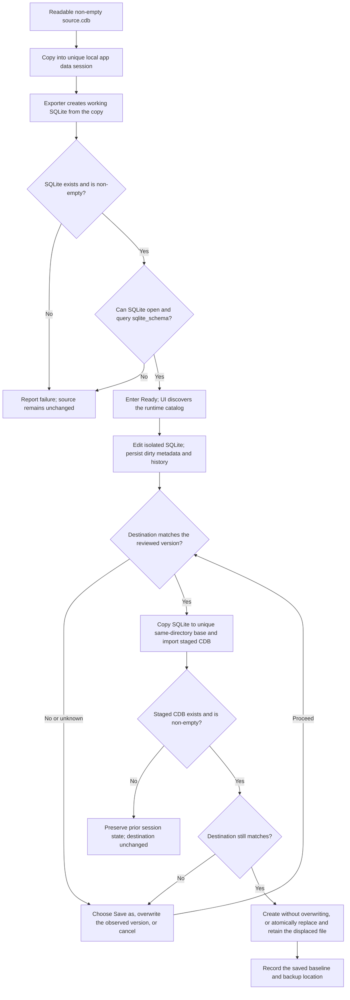

# Safety and recovery

SQLiteExporter receives an isolated working copy or staged SQLite file. Editing occurs in the working session. Save checks the destination and requires a non-empty staged CDB before replacement.



The staged-output check verifies that the expected CDB exists and is non-empty. Reopen the saved CDB in the editor when you need to verify its contents.

The converter can change stored values during a round trip. On a copied career it refreshed the SQLite import and export tags and converted blank rider Limits from SQLite `NULL` to integer zero. The editor's typed review describes values in the working copy.

## Open rules

1. Accept only an existing, readable, non-empty `.cdb` file.
2. Create `%LOCALAPPDATA%\PcmCdbEditor\Sessions\<session-id>`.
3. Copy the source into the session as the working CDB.
4. Invoke `SQLiteExporter.exe -a -export <working-copy>` with `ProcessStartInfo.ArgumentList`, never a shell or concatenated command string.
5. Require the resulting SQLite file to exist and be non-empty.
6. Open the SQLite file read-only and require `SELECT COUNT(*) FROM sqlite_schema` to succeed.
7. Enter Ready, after which the UI discovers the runtime catalog and attaches disk-backed edit history to the activated session.

Failure or cancellation leaves the original unchanged. Invalid newly created temporary state is cleaned best effort; a valid dirty session is never silently deleted.

## Save and Save as rules

The import boundary is:

```text
SQLiteExporter.exe -a -import <temporary-output-base>
```

Before invocation, the working SQLite database is copied to `<temporary-output-base>.sqlite`. The base is unique and in the destination directory so final replacement does not cross volumes.

The editor fingerprints the current destination at open and after each successful save. Save as records the chosen file's state when the picker returns. If the destination differs before or after staging, the editor asks you to choose **Save as**, explicitly overwrite the observed version, or cancel. A recovered session created before destination fingerprints were stored requires the same decision. Overwrite authorization applies to the version shown by that decision.

A new destination is created without overwriting another file. When a destination exists, Windows atomically replaces it and preserves the actual displaced file. The editor moves that backup to `%LOCALAPPDATA%\PcmCdbEditor\Backups` when possible. **Save details** shows its actual location, which can be beside the destination. If another process changes the file at the final replacement boundary, the editor preserves the displaced version and warns you. An unchanged zero-byte picker placeholder needs no retained backup. Managed session directories cannot be save destinations.

Open/export/stage work remains cancellable. Once final replacement starts, cancellation is deliberately ignored until that short commit boundary completes. A failed save preserves the session's prior dirty state. A successful commit advances the persisted saved baseline and clears dirty state when present. A metadata/history-baseline failure after a successful commit is surfaced explicitly rather than pretending the session is fully synchronized.

## Converter containment

- Default and maximum timeout: ten minutes.
- Standard output and error are drained concurrently and capped at 16,384 UTF-16 code units each.
- Known file paths are redacted and control characters are sanitized before diagnostics cross the process boundary.
- Active cancellation or timeout terminates the process tree.
- A zero exit code is insufficient; the expected output must exist and be non-empty.
- The exporter is opaque. Do not modify, decompile, invoke through a shell, or grant it the original CDB.

Integration tests cover missing or invalid inputs, start and exit failures, missing or empty output, diagnostic bounds and sanitization, literal arguments, cancellation, timeout, and child-process termination.

## Recovery and history

Session metadata identifies the source and save paths, destination fingerprint, working files, lifecycle, dirty state, pending mutation, history uncertainty, timestamps, and last backup. A normal startup shows **Recovery** when it finds a recoverable session. Select a row by its path, timestamp, and session ID, then choose **Resume selected** or **Discard selected**. Navigating away keeps the listed sessions available. Opening the app with a CDB path opens that file first. The Recovery page remains available from navigation.

Active sessions hold an exclusive lock. Recovery checks skip sessions in use by another current editor and leave unreadable or invalid sessions intact. The editor verifies the selection again before resuming or discarding it.

Disk-backed history is stored inside the session and can contain complete typed row snapshots required to undo deletes and maintenance, including BLOB bytes encoded in the history document. It is written atomically and uses row presence and revision guards during replay. **Changes** shows recorded operations, the next Undo and Redo, the saved baseline, and available before and after values. A new edit clears Redo. Ordinary Save and Save as preserve the recorded sequence while advancing the baseline.

Before a write, the app durably marks its mutation pending. It clears that marker only after the corresponding history record or replay completion is durable, or the operation is known to have made no change. An interrupted write or save, invalid history, or missing recovered history keeps the working copy unsaved through subsequent edits and Undo. An explicit successful save establishes a new baseline and retires uncertain Undo and Redo entries. The app preserves unreadable history for diagnosis.

Generic writes and replay refuse triggers, cascading referential actions, and allocation-counter changes that their row-level history cannot restore. Insert reads the actual SQLite-returned identity and verifies its row within the transaction. SQLite constraint rejection leaves a row-dialog draft available for correction; an ambiguous commit is kept as unsaved recovery work rather than offered as a safe retry.

Settings are stored separately. They do not contain database row values, but they can contain schema and table names plus up to twelve recent CDB filesystem paths. Treat settings, sessions, history, and backups as sensitive user data. Do not attach them to issues, commit them, or copy their contents into logs.

Recovery after abnormal termination is best effort, not general crash repair. Incomplete or unreadable metadata, a missing or empty working CDB, or an invalid working SQLite file prevents a session from being offered at startup. Retain an independent backup of valuable data.

## SQLite cancellation

Catalog, page/count, edit/replay, workspace-validation, and maintenance SQLite operations run through one internal worker boundary so synchronous native database work does not occupy the WinUI dispatcher. A cancellation request calls `sqlite3_interrupt` on the active connection. The registration is disposed before the connection, and an `SQLITE_INTERRUPT` becomes `OperationCanceledException` only when the caller's token was canceled.

Write paths attempt rollback without reusing the canceled token. SQLite may already have rolled back the transaction after an interrupt; the cleanup path preserves the original cancellation while accepting that native autocommit state. Synthetic long-read and long-write tests verify interruption, rollback safety, and successful use of the database afterward.

## Close, uninstall, and cleanup

Closing a table tab retains database edits and does not prompt. Replacing the open database or closing the app prompts when doing so could discard dirty work.

Uncreated Create Rider input has a separate discard decision. Saving a CDB does not create or save that draft. Cancelled close/replacement decisions retain its values, and exclusive operations prevent new input from arriving after the discard decision.

The app removes the active session after an ordinary clean close or an explicitly confirmed discard. In **Recovery**, **Clean completed sessions** checks closed or cancelled sessions and removes only completed, clean records after confirmation. Recoverable sessions and CDB backups remain available.

The installer is configured per user under `%LOCALAPPDATA%\Programs\PcmCdbEditor`. Settings, sessions, and backups live under `%LOCALAPPDATA%\PcmCdbEditor`, outside installed application files. Ordinary uninstall removes the application and file-association registration but intentionally preserves that user data; reinstalling or uninstalling is not a cleanup mechanism.

## User precautions

Use only data you are authorized to modify. Retain an independent backup, inspect the reported destination/backup outcome after saving, and do not rely on a prerelease session as the only copy of valuable data.
